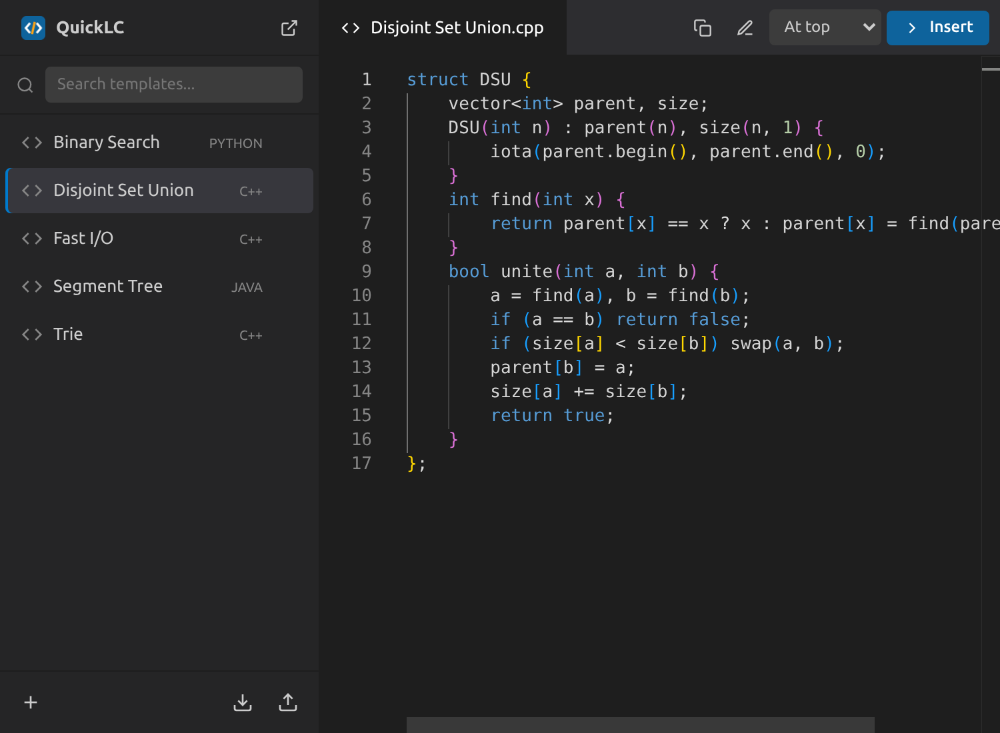
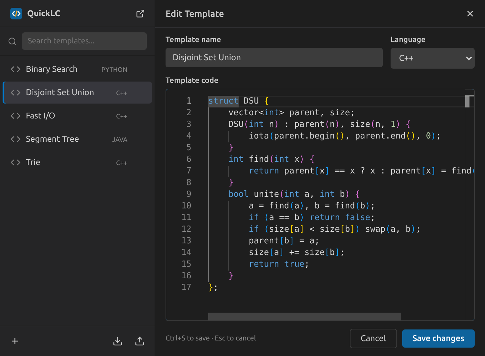

# QuickLC

QuickLC is a Chrome extension for keeping your own code templates (DSU, segment tree, fast I/O, binary search, ...) and inserting them into the LeetCode editor with one click or one keystroke. Templates are stored in the browser, so no server or database is needed.

## Features

* **Template management:** create, edit, search, and delete templates
* **One-click insert:** put a template at the top of the LeetCode editor (above `class Solution`) or at your cursor
* **Undo-friendly:** an insert is a single edit, so `Ctrl+Z` in LeetCode reverts it
* **Language check:** warns you when the template's language differs from the language selected in LeetCode
* **Keyboard-first:** open with `Alt+Shift+L`, type to filter, press `Enter` to insert
* **Monaco editor:** the same editor LeetCode and VS Code use, with syntax highlighting for C++, C, Java, Python, JavaScript, TypeScript, Go, Rust, C#, Kotlin, and Swift
* **Import / export:** back up templates as JSON, or move them to another browser
* **Local storage:** templates live in `chrome.storage.local` and never leave your machine

## Screenshots

### Template view


### Editing a template


## Installation

### Prerequisites

* [Node.js](https://nodejs.org/) 18 or newer (only used once, to download the Monaco editor)
* Google Chrome or another Chromium-based browser

### Steps

1. Clone the repository:
   ```bash
   git clone https://github.com/arpitkumar0007/QuickLC.git
   cd QuickLC
   ```

2. Install dependencies. This also copies the Monaco editor into `extension/vendor/`:
   ```bash
   npm install
   ```

3. Load the extension in Chrome:
   * Open `chrome://extensions`
   * Turn on **Developer mode**
   * Click **Load unpacked**
   * Select the `extension` folder

The extension still works if you skip step 2. It then uses a plain text editor instead of Monaco.

## Usage

1. Open a problem on [LeetCode](https://leetcode.com/problems/two-sum/).
2. Click the QuickLC icon in the toolbar, or press `Alt+Shift+L`.
3. Click **+** to create a template, or pick an existing one.
4. Click **Insert**, double-click the template, or press `Enter` in the search box.

Use the **At top / At cursor** menu to choose where the template goes.

### Keyboard shortcuts

| Shortcut | Action |
| --- | --- |
| `Alt+Shift+L` | Open QuickLC (change it at `chrome://extensions/shortcuts`) |
| `↑` / `↓` in search | Select the previous or next template |
| `Enter` in search, or `Ctrl+Enter` | Insert the selected template |
| `Ctrl+S` | Save the template you are editing |
| `Esc` | Close the template form |

### Backup and import

* **Export** (upload icon) downloads all templates as a JSON file.
* **Import** (download icon) opens QuickLC in a full tab, because a file picker can close the toolbar popup. Click import again there and choose the file. Duplicate templates are skipped.

#### Moving from QuickLC 1.x (MongoDB backend)

Version 1.x stored templates in MongoDB through a local Express server. That server is gone. To keep your templates, start the old server one last time and save its data:

```bash
curl http://localhost:5000/templates > quicklc-backup.json
```

Then import `quicklc-backup.json` as described above.

## Project structure

```
extension/
├── manifest.json     Manifest V3 config
├── popup.html        Popup UI (also used as a full-tab page with ?tab=1)
├── popup.css
├── popup.js          Storage, UI, and the function injected into LeetCode
├── icons/
└── vendor/           Monaco editor (generated by npm install, not committed)
scripts/
├── vendor-monaco.js  Copies Monaco from node_modules into extension/vendor
└── package.js        Builds dist/quicklc-<version>.zip for the Chrome Web Store
```

To build a zip for the Chrome Web Store, run `npm run package`.

## How it works

LeetCode's code editor is a Monaco editor exposed as `window.monaco`. When you click **Insert**, the popup uses `chrome.scripting.executeScript` to run a small function in the page. The function finds the largest writable editor, which is the solution editor, and applies the template with `executeEdits`. It retries for up to 5 seconds while the editor loads.

## Permissions

* `activeTab`, `scripting`: insert code into the LeetCode tab you are on
* `storage`: save your templates locally
* Host access to `leetcode.com` and `leetcode.cn`: find and insert into LeetCode tabs from the full-tab view

## Troubleshooting

* **"Open a LeetCode problem in this tab first."** The current tab is not on leetcode.com or leetcode.cn.
* **"Couldn't find the code editor on this page."** Open a problem page, wait for the editor to load, and try again.
* **Plain text editor instead of syntax highlighting:** run `npm install` and reload the extension at `chrome://extensions`.
